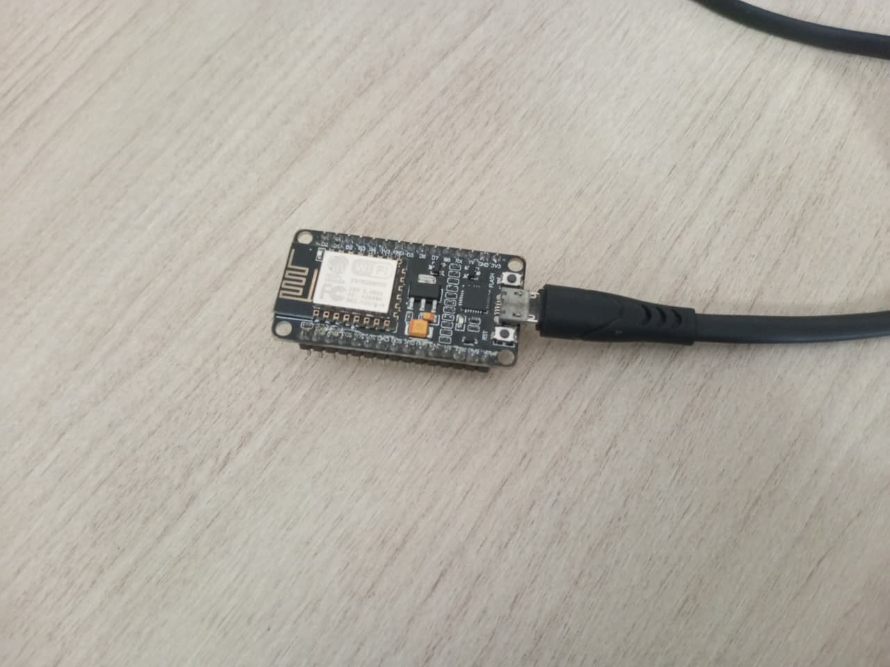
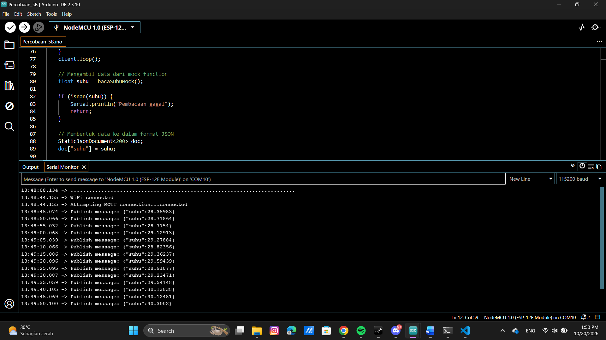
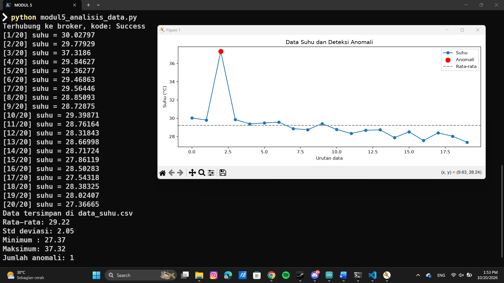

# Pertemuan 5 - Pengolahan dan Analisis Data IoT

## Tujuan dan Penjelasan Singkat
Praktikum pada Pertemuan 5 ini berfokus pada tahapan pengolahan, analisis, dan visualisasi data pada sistem IoT:
1. Tahapan Pengolahan Data IoT: Memahami alur pengelolaan data mulai dari akuisisi sensor, pembersihan derau (filtering), analisis statistik, hingga visualisasi.
2. Edge Processing & Moving Average: Mengimplementasikan penyaringan data mentah menggunakan filter moving average dan melacak nilai ekstrem (minimum/maksimum) secara langsung di sisi perangkat ESP8266.
3. Akuisisi MQTT ke Python: Mengimplementasikan skrip Python untuk berlangganan (subscribe) data telemetri melalui broker MQTT dan menyimpannya secara otomatis ke dalam format berkas CSV.
4. Analisis Statistik & Deteksi Anomali: Memanfaatkan pustaka Pandas untuk menghitung statistik deskriptif (rata-rata dan standar deviasi) serta mendeteksi anomali data menggunakan ambang batas z-score ($|z| > 2$).

## Peralatan yang Diperlukan
<div align="center">
<table border="1" cellpadding="10" cellspacing="0" width="100%">
  <tr align="center">
    <th>ESP8266</th>
    <th>Kabel Micro USB</th>
    <th>Arduino IDE</th>
  </tr>

  <tr align="center">
    <td>
      <br>
    </td>
    <td>
      <br>
    </td>
    <td>
      <br>
    </td>
  </tr>
</table>
</div>

## Percobaan 5A
### Gambaran Umum 
Percobaan 5A bertujuan untuk menerapkan teknik pengolahan data di sisi perangkat (*edge processing*) menggunakan mikrokontroler ESP8266. Program membaca data suhu tiruan (*mock function*), menerapkan filter *moving average* dengan jendela $N = 5$ untuk meredam fluktuasi acak (*noise*), serta melacak nilai suhu minimum dan maksimum secara *real-time*. Hasil pengolahan data ini ditampilkan langsung melalui Serial Monitor.

### Skematik Percobaan
```
[ Simulasi Sensor DHT22 / Mock Function ]
│
▼
[ ESP8266 (Edge Processing) ]
├── Filter Moving Average (N=5)
├── Pelacakan Suhu Min & Max
│
▼
[ Serial Monitor ]
```

### Kode Program
```cpp
const int N = 5; // jumlah sampel moving average
float buffer[N]; // menyimpan N pembacaan terakhir
int indeks = 0; // posisi penulisan berikutnya pada buffer
int jumlah = 0; // jumlah sampel yang sudah terisi

float suhuMin = 1000.0;
float suhuMax = -1000.0; // Diubah sedikit dari modul agar logika perbandingan suhu maksimum berjalan dengan benar

// Mock function pengganti sensor DHT22
float bacaSuhuMock() {
    static unsigned long jumlahBaca = 0;
    jumlahBaca++;

    // Suhu dasar berubah secara bertahap
    float suhuDasar = 28.0 + 2.0 * sin(jumlahBaca * 0.08);

    // Noise kecil untuk mensimulasikan fluktuasi sensor
    float noise = random(-5, 6) * 0.1;

    float suhu = suhuDasar + noise;

    // Lonjakan suhu setiap 25 pembacaan untuk simulasi anomali
    if (jumlahBaca % 25 == 0) {
        suhu += 8.0;
    }

    return suhu;
}

float hitungMovingAverage(float nilaiBaru) {
    buffer[indeks] = nilaiBaru;
    indeks = (indeks + 1) % N;
    if (jumlah < N) jumlah++;
    
    float total = 0;
    for (int i = 0; i < jumlah; i++) {
        total += buffer[i];
    }
    
    return total / jumlah;
}

void setup() {
    Serial.begin(115200);
    // Inisialisasi dht.begin() dihapus karena menggunakan simulasi
}

void loop() {
    // Mengambil data dari fungsi simulasi
    float suhu = bacaSuhuMock();

    if (isnan(suhu)) {
        Serial.println("Pembacaan gagal, data diabaikan");
    } else {
        float suhuFilter = hitungMovingAverage(suhu);
        
        if (suhu < suhuMin) suhuMin = suhu;
        if (suhu > suhuMax) suhuMax = suhu;

        Serial.print("Mentah: ");
        Serial.print(suhu);
        Serial.print(" | Filter: ");
        Serial.print(suhuFilter);
        Serial.print(" | Min: ");
        Serial.print(suhuMin);
        Serial.print(" | Max: ");
        Serial.println(suhuMax);
    }

    delay(2000);
}
```

### Penjelasan Kode per Baris Fungsi
1. `const int N = 5; float buffer[N];` : Menetapkan ukuran jendela sampel moving average sebanyak 5 data dan mendeklarasikan larik buffer untuk menyimpan pembacaan terakhir.
2. `int indeks = 0; int jumlah = 0;` : Menyiapkan variabel penunjuk posisi penyimpanan data berikutnya pada buffer dan penghitung jumlah sampel yang telah terisi.
3. `float suhuMin = 1000.0; float suhuMax = -1000.0;` : Inisialisasi nilai awal ekstrem untuk pelacakan suhu terendah dan tertinggi sejak program berjalan.
4. `float bacaSuhuMock() { ... }` : Fungsi simulasi untuk membangkitkan data suhu tiruan secara periodik lengkap dengan sisipan *noise* dan lonjakan anomali.
5. `float hitungMovingAverage(float nilaiBaru) { ... }` : Fungsi utama pengolah data untuk memasukkan nilai baru ke dalam *circular buffer*, memperbarui indeks via operasi modulo, dan menghitung rata-rata dari data yang tersedia.
6. `buffer[indeks] = nilaiBaru; indeks = (indeks + 1) % N;` : Menyimpan data suhu ke posisi indeks saat ini, lalu menggeser indeks secara melingkar (*circular*) menggunakan operasi modulo.
7. `float total = 0; for (...) total += buffer[i]; return total / jumlah;` : Melakukan iterasi penjumlahan seluruh elemen di dalam buffer lalu membaginya dengan jumlah sampel untuk mendapatkan nilai rata-rata bergerak.
8. `void setup() { Serial.begin(115200); }` : Menginisialisasi kecepatan komunikasi serial pada baud rate 115200 untuk pemantauan data.
9. `float suhu = bacaSuhuMock();` : Memanggil fungsi tiruan untuk mendapatkan sampel data suhu terbaru pada setiap siklus *loop*.
10. `float suhuFilter = hitungMovingAverage(suhu);` : Memproses data suhu mentah melalui fungsi filter *moving average*.
11. `if (suhu < suhuMin) suhuMin = suhu; if (suhu > suhuMax) suhuMax = suhu;` : Membandingkan dan memperbarui rekam nilai suhu minimum dan maksimum secara berkala.
12. `Serial.print(...)` : Mencetak parameter data mentah, data hasil filter, nilai minimum, dan maksimum ke Serial Monitor.

### Library/Dependencies yang Dibutuhkan
1. Arduino.h (Pustaka inti kerangka kerja Arduino).
2. math.h (Pustaka standar matematika untuk fungsi trigonometri, `pow()`, dan `sqrt()` pada modul modifikasi).

### Pertanyaan Praktikum
1. Gambarkan diagram alur (flowchart) proses perhitungan moving average pada fungsi hitungMovingAverage()!
2. Jelaskan fungsi dari operasi (indeks + 1) % N pada program tersebut!
3. Apa dampaknya terhadap data hasil filter apabila nilai N diperbesar menjadi 20 atau diperkecil menjadi 2?
4. Modifikasi program agar ESP32 juga menghitung simpangan baku dari data pada buffer, dan berikan penjelasan di setiap baris kode yang ditambahkan dalam bentuk README.md.


### Jawaban Praktikum
1. Flowchart proses perhitungan Moving Average
<div align="center">
  
</div>

2. Operasi (indeks + 1) % N berfungsi untuk mengimplementasikan circular buffer (buffer melingkar). Operasi Modulo (%) memastikan nilai variabel indeks selalu berada dalam rentang 0 hingga N - 1. Ketika indeks mencapai nilai N - 1 (misal 4 untuk N = 5), penambahan nilai berikutnya ((4 + 1) \% 5 = 0) akan mengembalikan indeks kembali ke posisi 0.   Tujuannya agar data pembacaan sensor yang baru akan secara otomatis menimpa data lama (yang paling awal dicatat). Hal ini menjaga buffer agar selalu menyimpan N sampel pembacaan paling akhir tanpa perlu menggeser elemen array secara manual.
3. Terdapat dua kondisi yaitu:
  - Jika N Diperbesar (N=20):
      - Efek Filter: Kurva grafik/data hasil pemrosesan menjadi sangat halus karena derau/fluktuasi acak teredam dengan lebih efektif.
      - Kelemahan: Respons sistem terhadap perubahan suhu lingkungan yang aktual menjadi sangat lambat (terlalu terdistorsi/delay). Lonjakan atau anomali suhu singkat akan tersamarkan oleh rata-rata 20 data sebelumnya.
  - Jika N Diperkecil (N=2):
      - Efek Filter: Respons sistem terhadap perubahan suhu aktual menjadi sangat cepat dan sensitif.
      - Kelemahan: Hasil penyaringan data kurang halus. Filter masih melewatkan derau/fluktuasi fluktuatif yang tinggi karena rata-rata hanya diambil dari 2 sampel terakhir.
4. Kode Modifikasi
```cpp
#include <Arduino.h>
#include <math.h> // Pustaka math untuk fungsi sqrt() dan pow()

const int N = 5;
float buffer[N];
int indeks = 0;
int jumlah = 0;

float suhuMin = 1000.0;
float suhuMax = -1000.0;

float bacaSuhuMock() {
    static unsigned long jumlahBaca = 0;
    jumlahBaca++;
    float suhuDasar = 28.0 + 2.0 * sin(jumlahBaca * 0.08);
    float noise = random(-5, 6) * 0.1;
    float suhu = suhuDasar + noise;

    if (jumlahBaca % 25 == 0) {
        suhu += 8.0;
    }
    return suhu;
}

float hitungMovingAverage(float nilaiBaru) {
    buffer[indeks] = nilaiBaru;
    indeks = (indeks + 1) % N;
    if (jumlah < N) jumlah++;
    
    float total = 0;
    for (int i = 0; i < jumlah; i++) {
        total += buffer[i];
    }
    return total / jumlah;
}

// Fungsi baru untuk menghitung Simpangan Baku (Standar Deviasi)
float hitungSimpanganBaku(float mean) {
    if (jumlah < 2) return 0.0; // Minimal 2 data untuk menghitung varians sampel
    
    float jumlahKuadratSelisih = 0.0;
    for (int i = 0; i < jumlah; i++) {
        jumlahKuadratSelisih += pow(buffer[i] - mean, 2);
    }
    
    float varians = jumlahKuadratSelisih / (jumlah - 1); // Varians sampel (N - 1)
    return sqrt(varians); // Akar kuadrat varians = standar deviasi
}

void setup() {
    Serial.begin(115200);
}

void loop() {
    float suhu = bacaSuhuMock();

    if (isnan(suhu)) {
        Serial.println("Pembacaan gagal, data diabaikan");
    } else {
        float suhuFilter = hitungMovingAverage(suhu);
        float stdDev = hitungSimpanganBaku(suhuFilter); // Hitung Simpangan Baku
        
        if (suhu < suhuMin) suhuMin = suhu;
        if (suhu > suhuMax) suhuMax = suhu;

        Serial.print("Mentah: ");
        Serial.print(suhu);
        Serial.print(" | Filter: ");
        Serial.print(suhuFilter);
        Serial.print(" | StdDev: ");
        Serial.print(stdDev);
        Serial.print(" | Min: ");
        Serial.print(suhuMin);
        Serial.print(" | Max: ");
        Serial.println(suhuMax);
    }

    delay(2000);
}
```

#### Penjelasan Baris Kode Modifikasi:
- `#include <math.h>` : Mengimpor pustaka matematika untuk mendukung operasi perhitungan akar kuadrat (`sqrt`) dan perpangkatan (`pow`) dalam penentuan standar deviasi.
- `float hitungSimpanganBaku(float mean) { ... }` : Fungsi tambahan untuk menghitung variasi atau tingkat sebaran data suhu di dalam buffer terhadap nilai rata-ratanya.
- `if (jumlah < 2) return 0.0;` : Pengaman logika untuk menghindari pembagian dengan nilai nol (*division by zero*) saat jumlah sampel kurang dari dua.
- `jumlahKuadratSelisih += pow(buffer[i] - mean, 2);` : Menghitung jumlah kuadrat selisih antara masing-masing elemen data dalam buffer dengan nilai rata-ratanya (*mean*).
- `float varians = jumlahKuadratSelisih / (jumlah - 1);` : Menghitung nilai varians sampel dengan derajat kebebasan $N - 1$.
- `return sqrt(varians);` : Menghitung akar kuadrat dari varians untuk menghasilkan nilai simpangan baku ($\sigma$).
- `float stdDev = hitungSimpanganBaku(suhuFilter);` : Memanggil fungsi perhitungan simpangan baku di dalam siklus *loop* dengan parameter acuan nilai rata-rata *moving average*.

### Dokumentasi
<div align="center">
<table border="1" cellpadding="10" cellspacing="0" width="100%">
    <td>
      <br>
    </td>
    <td>
      <br>
    </td>
  </tr>
</table>
</div>

## Percobaan 5B
### Gambaran Umum 
Percobaan 5B berfokus pada pengolahan, analisis, dan visualisasi data di sisi komputer (*server/PC processing*). Mikrokontroler ESP8266 mengirimkan data suhu tiruan secara periodik melalui protokol MQTT ke broker publik (`broker.hivemq.com`). Program berbasis Python kemudian berlangganan (*subscribe*) pada topik tersebut, merekam data ke dalam berkas CSV, melakukan analisis statistik deskriptif, mendeteksi anomali menggunakan metode *z-score* ($|z| > 2$), serta menghasilkan plot visualisasi grafik.

### Skematik Percobaan
```
[ ESP8266 ] ──(Publish via MQTT)──> [ Broker MQTT (HiveMQ) ]
│
(Subscribe / Terima Data)
│
▼
[ Skrip Python (PC / Laptop) ]
├── Simpan ke Berkas CSV
├── Analisis Statistik & Z-Score
└── Visualisasi Grafik Matplotlib
```

### Kode Program
```cpp
#include <ESP8266WiFi.h> // Library khusus untuk ESP8266
#include <PubSubClient.h>
#include <ArduinoJson.h>

// WAJIB DIUBAH: Masukkan nama dan password WiFi/Tethering kamu
const char* ssid = "NAMA_WIFI_KAMU"; 
const char* password = "PASSWORD_WIFI_KAMU";

// Pengaturan Broker MQTT publik
const char* mqtt_server = "broker.hivemq.com";
// PENTING: Sesuaikan topic ini agar SAMA PERSIS dengan program Python!
const char* topic_data = "unsoed/tk245004/kelompokAnda/data";

WiFiClient espClient;
PubSubClient client(espClient);

// Mock function pengganti sensor DHT22
float bacaSuhuMock() {
    static unsigned long jumlahBaca = 0;
    jumlahBaca++;

    float suhuDasar = 28.0 + 2.0 * sin(jumlahBaca * 0.08);
    float noise = random(-5, 6) * 0.1;
    float suhu = suhuDasar + noise;

    // Lonjakan suhu setiap 25 pembacaan untuk simulasi anomali
    if (jumlahBaca % 25 == 0) {
        suhu += 8.0;
    }
    return suhu;
}

void setup_wifi() {
    delay(10);
    Serial.println();
    Serial.print("Connecting to ");
    Serial.println(ssid);
    
    WiFi.begin(ssid, password);
    
    while (WiFi.status() != WL_CONNECTED) {
        delay(500);
        Serial.print(".");
    }
    Serial.println("");
    Serial.println("WiFi connected");
}

void reconnect() {
    while (!client.connected()) {
        Serial.print("Attempting MQTT connection...");
        // Membuat Client ID acak
        String clientId = "ESP8266Client-";
        clientId += String(random(0xffff), HEX);
        
        if (client.connect(clientId.c_str())) {
            Serial.println("connected");
        } else {
            Serial.print("failed, rc=");
            Serial.print(client.state());
            Serial.println(" try again in 5 seconds");
            delay(5000);
        }
    }
}

void setup() {
    Serial.begin(115200);
    setup_wifi();
    client.setServer(mqtt_server, 1883);
}

void loop() {
    if (!client.connected()) {
        reconnect();
    }
    client.loop();

    // Mengambil data dari mock function
    float suhu = bacaSuhuMock();

    if (isnan(suhu)) {
        Serial.println("Pembacaan gagal");
        return;
    }

    // Membentuk data ke dalam format JSON
    StaticJsonDocument<200> doc;
    doc["suhu"] = suhu;

    char jsonBuffer[512];
    serializeJson(doc, jsonBuffer);

    // Publikasi data ke broker
    Serial.print("Publish message: ");
    Serial.println(jsonBuffer);
    client.publish(topic_data, jsonBuffer);

    // Interval publish 5 detik
    delay(5000);
}
```

### Penjelasan Kode per Baris Fungsi
1. `#include <ESP8266WiFi.h>, <PubSubClient.h>, <ArduinoJson.h>` : Mengimpor pustaka utama untuk koneksi WiFi ESP8266, komunikasi protokol MQTT, dan serialisasi data berformat JSON.
2. `const char* ssid & password` : Variabel kredensial untuk menghubungkan ESP8266 ke jaringan WiFi/Hotspot lokal.
3. `const char* mqtt_server = "broker.hivemq.com";` : Menentukan alamat peladen broker MQTT publik yang digunakan sebagai pusat pertukaran pesan.
4. `WiFiClient espClient; PubSubClient client(espClient);` : Inisialisasi klien jaringan dan klien MQTT.
5. `float bacaSuhuMock() { ... }` : Fungsi pembangkit data suhu tiruan berserta gangguan (*noise*) dan lonjakan anomali berkala.
6. `void setup_wifi() { ... }` : Prosedur untuk menghubungkan mikrokontroler ESP8266 ke jaringan nirkabel router.
7. `void reconnect() { ... }` : Prosedur penanganan koneksi ulang otomatis ke broker MQTT apabila koneksi terputus di tengah jalan.
8. `StaticJsonDocument<200> doc; doc["suhu"] = suhu;` : Membuat dokumen JSON berkapasitas 200 byte dan menyarikan data suhu ke dalam kunci berlabel `"suhu"`.
9. `serializeJson(doc, jsonBuffer);` : Mengubah objek dokumen JSON menjadi string teks berformat JSON untuk kemudian dikirimkan.
10. `client.publish(topic_data, jsonBuffer);` : Mempublikasikan paket data suhu berformat JSON ke topik MQTT tujuan.

### Library/Dependencies yang Dibutuhkan
1. ESP8266WiFi.h (Pustaka internal ESP8266 Core).
2. PubSubClient oleh Nick O'Leary.
3. ArduinoJson oleh Benoit Blanchon (versi 6/7).
4. Python 3 terpasang pada komputer/PC.
5. Pustaka Python: `paho-mqtt`, `pandas`, dan `matplotlib`.

### Pertanyaan Praktikum
1. Jelaskan fungsi dari blok try-except pada fungsi on_message() dan apa yang terjadi apabila blok tersebut dihilangkan!
2. Jelaskan arti nilai z-score dan mengapa batas |z| > 2 digunakan sebagai penentu anomali!
3. Apa kelemahan metode z-score apabila data memiliki tren naik atau turun yang tajam?
4. Modifikasi program agar menggunakan metode moving average (jendela 5 data) pada data hasil CSV sebelum dihitung z-score-nya, kemudian bandingkan jumlah anomali yang terdeteksi, dan berikan penjelasan di setiap baris kode yang ditambahkan dalam bentuk README.md.
aris Kode Modifikasi:

### Jawaban Praktikum
1. Blok try-except berfungsi untuk menangani galat secara otomatis ketika Python menerima pesan dari broker MQTT, sehingga program tidak mengalami crash atau terhenti di tengah jalan apabila format payload data tidak valid.
2. Z-score adalah nilai statistik yang menyatakan jarak penyimpangan suatu titik data dari rata-rata dalam satuan standar deviasi. Batas $\vert{}z\vert{} > 2$ dipilih sebagai penentu anomali karena secara distribusi normal, data di luar rentang tersebut sangat jarang terjadi (hanya sekitar 4,55%).
3. Metode z-score kurang optimal jika menghadapi data dengan tren naik atau turun yang tajam secara terus-menerus. Pergeseran nilai rata-rata keseluruhan dapat memicu anomali palsu (false positive) di awal tren atau menyebabkan lonjakan nyata di akhir tren gagal terdeteksi.
4. Kode Modifikasi
```cpp
import json
import time
import paho.mqtt.client as mqtt
import pandas as pd
import matplotlib.pyplot as plt

BROKER = "broker.hivemq.com"
PORT = 1883
TOPIC = "unsoed/tk245004/kelompokAnda/data"  # Sesuaikan dengan topic ESP8266
JUMLAH_SAMPEL = 20  # Jumlah data yang dikumpulkan

data = []

def on_connect(client, userdata, flags, reason_code, properties):
    print("Terhubung ke broker, kode:", reason_code)
    client.subscribe(TOPIC)

def on_message(client, userdata, msg):
    try:
        payload = json.loads(msg.payload.decode())
        suhu = float(payload["suhu"])
    except (ValueError, KeyError):
        print("Data tidak valid, diabaikan")
        return
    
    data.append({"waktu": time.strftime("%Y-%m-%d %H:%M:%S"), "suhu": suhu})
    print(f"[{len(data)}/{JUMLAH_SAMPEL}] suhu = {suhu}")
    
    if len(data) >= JUMLAH_SAMPEL:
        client.disconnect()

# -- Tahap 1: Akuisisi data dari MQTT
client = mqtt.Client(mqtt.CallbackAPIVersion.VERSION2)
client.on_connect = on_connect
client.on_message = on_message
client.connect(BROKER, PORT)
client.loop_forever()

# -- Tahap 2: Simpan ke CSV
df = pd.DataFrame(data)
df.to_csv("data_suhu.csv", index=False)
print("Data tersimpan di data_suhu.csv")

# -- Tahap 3: Analisis Statistik, Moving Average, dan Deteksi Anomali (Z-Score)
# Menerapkan filter Moving Average dengan jendela 5 data pada kolom suhu
df["suhu_ma"] = df["suhu"].rolling(window=5).mean()

# Mengisi nilai NaN (kosong) di awal baris moving average menggunakan data suhu asli
df["suhu_ma"] = df["suhu_ma"].fillna(df["suhu"])

# Menghitung rata-rata dan standar deviasi dari data yang telah difilter moving average
rata2 = df["suhu_ma"].mean()
std = df["suhu_ma"].std()

if std == 0:
    df["zscore"] = 0.0
else:
    df["zscore"] = (df["suhu_ma"] - rata2) / std

# Menentukan status anomali berdasarkan ambang batas |z| > 2
df["anomali"] = df["zscore"].abs() > 2

print(f"Rata-rata (MA): {rata2:.2f}")
print(f"Std deviasi (MA): {std:.2f}")
print(f"Minimum (MA)  : {df['suhu_ma'].min():.2f}")
print(f"Maksimum (MA) : {df['suhu_ma'].max():.2f}")
print(f"Jumlah anomali setelah Moving Average: {df['anomali'].sum()}")

# -- Tahap 4: Visualisasi
plt.figure(figsize=(10, 4))
plt.plot(df.index, df["suhu_ma"], marker="o", label="Suhu (Moving Average)")
anom = df[df["anomali"]]
plt.scatter(anom.index, anom["suhu_ma"], color="red", s=100, label="Anomali", zorder=3)
plt.axhline(rata2, color="gray", linestyle="--", label="Rata-rata")
plt.xlabel("Urutan data")
plt.ylabel("Suhu (°C)")
plt.title("Data Suhu (Moving Average) dan Deteksi Anomali Z-score")
plt.legend()
plt.tight_layout()
plt.savefig("grafik_suhu_ma.png")
plt.show()
```

#### Penjelasan Baris Kode Modifikasi: Moving Average Sebelum Z-Score
1. `df["suhu_ma"] = df["suhu"].rolling(window=5).mean();` : Menggunakan fungsi `rolling(window=5)` dari pustaka Pandas untuk membentuk jendela geser sepanjang 5 sampel data, lalu menghitung rata-ratanya guna meredam derau (*noise*) acak pada data suhu mentah.
2. `df["suhu_ma"] = df["suhu_ma"].fillna(df["suhu"]);` : Mengisi nilai kosong (`NaN`) pada 4 baris data pertama (karena belum memenuhi syarat jendela 5 sampel) dengan nilai suhu mentah aslinya agar program tidak mengalami galat pada perhitungan statistik selanjutnya.
3. `rata2 = df["suhu_ma"].mean();` : Menghitung ulang nilai rata-rata keseluruhan berdasarkan kolom data yang sudah melalui proses perataan *moving average*.
4. `std = df["suhu_ma"].std();` : Menghitung simpangan baku (standar deviasi) baru dari data yang telah difilter agar sebaran nilai lebih stabil.
5. `df["zscore"] = (df["suhu_ma"] - rata2) / std;` : Menghitung nilai *z-score* berdasarkan kolom `suhu_ma` terhadap rata-rata dan simpangan baku yang baru.
6. `df["anomali"] = df["zscore"].abs() > 2;` : Mengevaluasi ambang batas anomali dengan memeriksa apakah nilai mutlak *z-score* lebih besar dari 2.
7. `print(f"Jumlah anomali setelah Moving Average: {df['anomali'].sum()}");` : Mencetak total data yang terdeteksi sebagai anomali setelah perataan filter ke konsol terminal.

### Dokumentasi
<div align="center">
<table border="1" cellpadding="10" cellspacing="0" width="100%">
    <td>
      <br>
    </td>
    <td>
      <br>
    </td>
    <td>
      <br>
    </td>
  </tr>
</table>
</div>